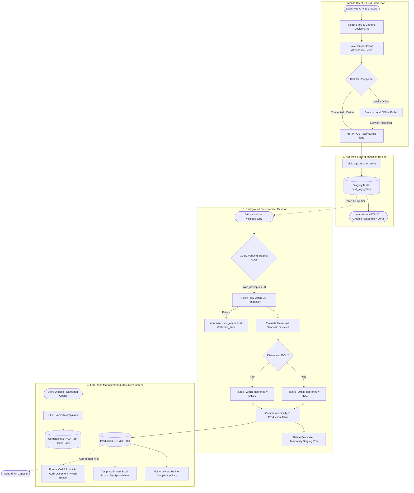

# 🌟 OmniForce SFA Enterprise™ Showcase
### Enterprise Sales Force Automation, Resilient Staging Pipelines & CAPA Audit Logistics

[](https://www.php.net/)
[](https://laravel.com/)
[](https://tailwindcss.com/)
[](https://alpinejs.dev/)
[](https://www.sqlite.org/)
[](https://phpspreadsheet.readthedocs.io/)
[](https://opensource.org/licenses/MIT)

> **🌐 Language / Bahasa:** **English (Current)** | [Bahasa Indonesia](README_ID.md)

---

> **👨‍💻 Primary Engineer Role:** **Backend Software Engineer & API Architect**  
> *This repository is an enterprise-grade reference implementation engineered from the perspective of a Backend Engineer. The embedded frontend interfaces (Smartphone Simulator and Web Management Console) serve as an interactive test harness and live evaluation suite to demonstrate and stress-test the backend architecture in real-time.*

---

## 📌 Executive Summary

**OmniForce SFA Enterprise™ Showcase** is a production-grade backend software engineering reference implementation demonstrating the **End-to-End Field Sales Automation & Distribution Audit Lifecycle**:

1. **Multi-Tier Territory & Customer Hierarchy:** Scalable relational mapping of operational territories (**Zone $\rightarrow$ Area $\rightarrow$ Retail Outlets**) with strict data isolation, route planning, and salesperson assignment matrices.
2. **Resilient Non-Blocking Staging Queue (Zero Data Loss):** Ingestion architecture tailored for low-connectivity environments (store basements, rural transit). Field submissions write directly into a staging buffer (`visit_logs_temp`) in **sub-20ms**, eliminating mobile client timeouts.
3. **Haversine Anti-Fraud Geofencing & Biometrics:** Mathematical distance computation validating field attendance coordinates against customer master geotags, reinforced by time-verified biometric selfie proof.
4. **Automated & On-Demand Atomic Sync Engine:** Dedicated background Artisan daemon (`php artisan visitlogs:sync`) executing database transaction commits, idempotency verification, and exponential backoff retry policies.
5. **Quality Dispute Resolution (PICA/CAPA) & Template Reporting:** Closed-loop incident reporting for damaged products or delivery shortages, complete with 5-Whys root cause analysis, automated Excel spreadsheet generation via PhpSpreadsheet, and ISO-standard printable audit documents.

---

## 🏗 System Architecture & Business Workflow



---

## ⚡ Engineering Highlights

### 1. Haversine Spherical Geodesic Geofencing Formula
To eliminate attendance fraud (*fake check-ins* or GPS spoofing), the backend calculates the great-circle distance between the field agent's recorded GPS coordinates and the retail store's master coordinates using the spherical Haversine trigonometric formula:

$$
\Delta \varphi = \varphi_2 - \varphi_1 \quad (\text{latitude difference in radians})
$$

$$
\Delta \lambda = \lambda_2 - \lambda_1 \quad (\text{longitude difference in radians})
$$

$$
a = \sin^2\left(\frac{\Delta \varphi}{2}\right) + \cos(\varphi_1) \cdot \cos(\varphi_2) \cdot \sin^2\left(\frac{\Delta \lambda}{2}\right)
$$

$$
c = 2 \cdot \text{atan2}\left(\sqrt{a}, \sqrt{1-a}\right)
$$

$$
d = R \cdot c \quad (\text{mean Earth radius } R = 6,371,000 \text{ meters})
$$

* **Valid Attendance Perimeter:** $d \le 250\text{ meters} \implies \text{Valid Attendance (is\_within\_geofence = true)}$.  
* **Geofence Violation:** $d > 250\text{ meters} \implies \text{Flagged as Outside Radius}$ (flagged automatically in management audit trail).

---

### 2. Fault-Tolerant Staging Ingestion Queue Pattern
When hundreds of field sales representatives submit attendance logs simultaneously during morning peak hours from basement retail stores, writing directly to the primary operational tables can cause database lock contention, latency spikes, and connection timeouts.
* **Architecture Solution:** Requests are received by a lightweight ingestion controller, written immediately to a staging buffer table (`visit_logs_temp`), and respond to the client with an HTTP 201 Created status in milliseconds.
* **Scheduled Background Worker:** A dedicated Artisan command (`php artisan visitlogs:sync`) polls pending rows, enforces idempotency, migrates data in atomic database transactions (`DB::beginTransaction()`), and applies an exponential backoff policy up to 20 retry attempts in case of transient failures.

---

### 3. High-Throughput Compliance & Performance Analytics Engine
The `/api/v1/visit-logs/analytics` endpoint processes operational data using high-performance aggregation queries to generate executive KPI metrics:
* **Schedule Compliance Rate:**
  $$
  \text{Compliance Rate} = \left(\frac{\sum \text{Visits}_{\text{within geofence}}}{\sum \text{Total Completed Visits}}\right) \times 100\%
  $$
* **Buffer Health Index:** Continuously monitors pending rows in `visit_logs_temp` to verify system-wide synchronization health and detect ingestion bottlenecks.

---

### 4. Template-Driven Document & Report Exporting Engine
Automates corporate administrative tasks by streaming enterprise-grade documents directly from the backend:
* **Streaming Excel Spreadsheet (`PhpSpreadsheet`):** Delivers clean `.xlsx` audit workbooks featuring auto-sized columns, cell styling, and conditional formatting indicators (`/export/visit-logs/excel`).
* **CAPA / PICA Audit Report Generator:** Compiles formal quality problem resolution reports adhering to ISO 9001 audit standards (including problem description, 5-Whys root cause analysis, corrective/preventive action matrices, and authorization signature blocks) ready for print (`/export/complaints/{id}/print`) or download as Microsoft Word documents (`/export/complaints/{id}/word`).

---

### 5. Zero-Setup Local Embedded SQLite Architecture
Configured with an embedded SQLite database orchestrated through official Laravel migrations and seeders. Anyone cloning this repository can immediately test and evaluate the entire backend workflow without installing or configuring external MySQL, PostgreSQL, or Redis instances.

---

## 📂 Repository Directory Layout

```text
omniforce-sfa-lite/
├── artisan                                # Laravel CLI Runner
├── composer.json                          # Backend Dependency Manifest
├── docker-compose.yml                     # 1-Click Docker Container Orchestration
├── .gitignore                             # Git ignore rules (sanitized .env & sqlite)
├── README.md                              # Primary International Documentation (English)
├── README_ID.md                           # Formal Technical Documentation (Bahasa Indonesia)
├── app/
│   ├── Console/
│   │   ├── Kernel.php                     # Task Scheduler & Cron Registration
│   │   └── Commands/
│   │       ├── ShowcaseSyncCommand.php    # Staging Queue Sync Worker (visitlogs:sync)
│   │       └── SeedShowcaseCommand.php    # Showcase Demo Dataset Seeder (showcase:seed)
│   ├── Http/
│   │   ├── Controllers/
│   │   │   ├── Controller.php             # Base Controller with Response Envelope
│   │   │   ├── Api/
│   │   │   │   ├── VisitLogController.php # Staging Ingestion & Analytics Endpoints
│   │   │   │   └── ComplaintController.php# Field Dispute & PICA Incident Endpoints
│   │   │   └── Web/
│   │   │       ├── DemoController.php     # UI Harness Controller (Simulator & Admin)
│   │   │       └── ExportController.php   # Excel Spreadsheet & Word Export Engine
│   ├── Models/
│   │   ├── Area.php                       # Operational Sales Territories
│   │   ├── Customer.php                   # Retail Store Outlets with GPS Coordinates
│   │   ├── User.php                       # System Accounts (Admin & Field Reps)
│   │   ├── VisitLog.php                   # Production Verified Attendance Records
│   │   ├── VisitLogTemp.php               # Offline Staging Queue Buffer Records
│   │   ├── Complaint.php                  # Product Dispute & Return Incidents
│   │   └── ComplaintPica.php              # 5-Whys Root Cause Investigation (CAPA)
│   ├── Services/
│   │   ├── DocumentExportService.php      # Formatted Excel Workbook Assembler
│   │   └── ExcelTemplateService.php       # Template Placeholder Substitution Engine
│   └── Traits/
│       ├── DocumentNumber.php             # Sequential Document Code Generator
│       └── SetReponses.php                # Standardized JSON Response Envelope
├── database/
│   ├── database.sqlite                    # Zero-config Embedded SQLite Database
│   ├── migrations/                        # Relational Schemas (UUID PK enabled)
│   └── seeders/DatabaseSeeder.php         # Demo Accounts, Territory, & Dispute Seeder
├── resources/views/
│   ├── layouts/app.blade.php              # Master Layout with Navigation Bar
│   └── demo/
│       ├── mobile.blade.php               # Test Harness: Sales Rep Smartphone Simulator
│       ├── admin.blade.php                # Test Harness: Enterprise Web Admin Console
│       ├── report_print.blade.php         # ISO-9001 Printable CAPA / PICA Audit Form
│       └── docs.blade.php                 # Interactive REST API Test Playground
├── routes/
│   ├── api.php                            # Versioned RESTful API Routes (v1)
│   ├── web.php                            # Demo Harness UI & Export Routes
│   └── console.php                        # Artisan CLI Command Routes
└── tests/Feature/
    └── VisitLogStagingTest.php            # Automated Tests: Staging, Sync & Export
```

---

## 🚀 Quick Start Guide (< 1 Minute Setup)

This repository includes a **zero-configuration embedded SQLite setup**, eliminating the need for external database servers.

### Option 1: Running Locally with PHP (Recommended)

```bash
# 1. Clone repository
git clone https://github.com/IraNuryani/omniforce-sfa-showcase.git
cd omniforce-sfa-showcase

# 2. Install backend dependencies
composer install

# 3. Setup environment and seed database
cp .env.example .env
php artisan key:generate
touch database/database.sqlite
php artisan migrate --force
php artisan showcase:seed

# 4. Start local development server
php artisan serve
```

Access the interactive interfaces in your browser:
* 📱 **Mobile Sales Rep Simulator:** [http://localhost:8000](http://localhost:8000)
* 🖥️ **Web Admin & Document Center:** [http://localhost:8000/demo/admin](http://localhost:8000/demo/admin)
* 📘 **Interactive API Explorer:** [http://localhost:8000/demo/docs](http://localhost:8000/demo/docs)

---

### Option 2: Running via Docker Compose

```bash
docker compose up -d
```
Open **[http://localhost:8000](http://localhost:8000)** in your browser.

---

## 🔑 Pre-Configured Demo Credentials

Pre-seeded demonstration accounts for evaluating role-based workflows:

| Role | Email Address | Password | Capabilities & Access Scope |
|---|---|---|---|
| **System Administrator** | `admin@omniforce.io` | `password` | Access Web Admin Console, view system-wide compliance analytics, download Excel audit workbooks, and print/export CAPA/PICA audit reports. |
| **Sales Representative** | `budi@omniforce.io` | `password` | Simulate mobile check-in visits, test GPS geofencing radius, submit selfie proof, and log store disputes (Territory: Jakarta Pusat). |
| **Sales Representative** | `rina@omniforce.io` | `password` | Simulate mobile visits for Jakarta Selatan territory. |
| **Sales Representative** | `dimas@omniforce.io` | `password` | Simulate mobile visits for Bandung Raya territory. |

---

## 🧪 Automated Testing Suite

Execute the automated test suite to validate the staging queue architecture and Haversine distance calculations:

```bash
php artisan test
```

Test coverage includes:
* ✅ **Non-Blocking Staging Ingestion:** Validates mobile attendance logs write directly to `visit_logs_temp` with HTTP 201 Created.
* ✅ **Atomic Background Synchronization:** Verifies atomic transaction migration to `visit_logs` and purge of processed temporary rows.
* ✅ **Distance Threshold Validation:** Confirms Haversine calculations accurately assign `is_within_geofence = true` for distances $\le 250\text{m}$.
* ✅ **Excel Export Stream Delivery:** Verifies the `/export/visit-logs/excel` endpoint returns a valid spreadsheet stream response.

---

## 📄 License & Attribution
Distributed under the [MIT](LICENSE) License. Open for technical evaluation, code review, and professional software engineering portfolio reference.
