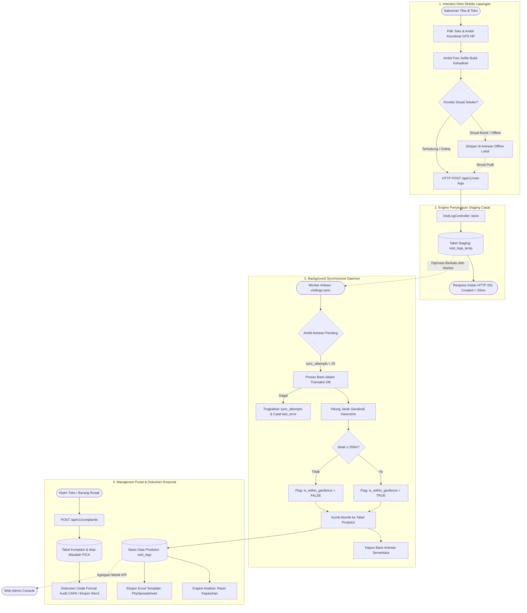

# 🌟 OmniForce SFA Enterprise™ Showcase
### Enterprise Sales Force Automation, Resilient Staging Pipelines & CAPA Audit Logistics

[](https://www.php.net/)
[](https://laravel.com/)
[](https://tailwindcss.com/)
[](https://alpinejs.dev/)
[](https://www.sqlite.org/)
[](https://phpspreadsheet.readthedocs.io/)
[](https://opensource.org/licenses/MIT)

> **🌐 Bahasa / Language:** **Bahasa Indonesia (Saat ini)** | [English](README.md)

---

> **👨‍💻 Peran Utama Pengembang:** **Backend Software Engineer & API Architect**  
> *Repositori ini merupakan implementasi acuan berskala produksi yang dirancang dari sudut pandang seorang Backend Engineer. Antarmuka frontend yang disertakan (Simulator Smartphone dan Web Admin Console) berfungsi sebagai test harness interaktif untuk mendemonstrasikan, menguji beban, dan mengevaluasi keandalan arsitektur backend secara langsung.*

---

## 📌 Executive Summary

**OmniForce SFA Enterprise™ Showcase** adalah implementasi portofolio rekayasa perangkat lunak backend berskala korporasi yang mendemonstrasikan **Siklus Hidup Lengkap Otomasi Penjualan Lapangan & Audit Distribusi (End-to-End Field Sales Automation & Distribution Audit Lifecycle)**:

1. **Multi-Tier Territory & Customer Hierarchy:** Pemetaan relasional berjenjang untuk wilayah operasional (**Zone $\rightarrow$ Area $\rightarrow$ Toko Retail**) dengan isolasi data yang ketat, perencanaan rute, dan matriks penugasan tenaga penjual.
2. **Resilient Non-Blocking Staging Queue (Zero Data Loss):** Arsitektur penyerapan data yang dirancang khusus untuk kondisi konektivitas rendah (basemen toko, rute pelosok). Data absensi ditulis langsung ke tabel antrean sementara (`visit_logs_temp`) dalam waktu **di bawah 20 milidetik**, mengeliminasi risiko *timeout* pada aplikasi mobile.
3. **Haversine Anti-Fraud Geofencing & Biometrics:** Komputasi jarak matematis untuk memvalidasi koordinat kehadiran fisik terhadap koordinat master toko ritel, diperkuat bukti foto selfie berstempel waktu terenkripsi.
4. **Automated & On-Demand Atomic Sync Engine:** Daemon Artisan latar belakang (`php artisan visitlogs:sync`) yang mengeksekusi komit transaksi basis data, verifikasi idempotensi, serta kebijakan *retry backoff*.
5. **Quality Dispute Resolution (PICA/CAPA) & Template Reporting:** Penanganan insiden kekurangan barang atau kerusakan barang terintegrasi dengan analisis akar masalah *5-Whys*, pembangkitan spreadsheet Excel otomatis via PhpSpreadsheet, dan penerbitan dokumen audit formal berstandar ISO.

---

## 🏗 Arsitektur Sistem & Alur Bisnis



---

## ⚡ Fitur Rekayasa Unggulan (Engineering Highlights)

### 1. Formulasi Matematis Geofencing Haversine
Untuk mengeliminasi kecurangan absensi (*fake check-in*), backend mengimplementasikan formula trigonometri sferis Haversine guna menghitung jarak lingkaran besar (*great-circle distance*) antara koordinat GPS perangkat sales dengan koordinat master toko:

$$
\Delta \varphi = \varphi_2 - \varphi_1 \quad (\text{perbedaan lintang / latitude})
$$

$$
\Delta \lambda = \lambda_2 - \lambda_1 \quad (\text{perbedaan bujur / longitude})
$$

$$
a = \sin^2\left(\frac{\Delta \varphi}{2}\right) + \cos(\varphi_1) \cdot \cos(\varphi_2) \cdot \sin^2\left(\frac{\Delta \lambda}{2}\right)
$$

$$
c = 2 \cdot \text{atan2}\left(\sqrt{a}, \sqrt{1-a}\right)
$$

$$
d = R \cdot c \quad (\text{dengan radius rata-rata bumi } R = 6.371.000 \text{ meter})
$$

* **Ambang Batas Kehadiran Valid:** $d \le 250\text{ meter} \implies \text{Valid Attendance (is\_within\_geofence = true)}$.  
* **Pelanggaran Geofence:** $d > 250\text{ meter} \implies \text{Flagged as Outside Radius}$ (ditandai otomatis pada audit trail manajemen).

---

### 2. Pola Antrean Staging Tahan Gangguan Jaringan (*Fault-Tolerant Staging Queue*)
Ketika ratusan tenaga penjual melakukan absensi serentak di pagi hari dari area basemen toko retail, pemrosesan transaksi basis data secara langsung (*synchronous write to main table*) dapat menimbulkan *database lock contention*, lonjakan latensi, dan *connection timeout*.
* **Arsitektur Solusi:** Permintaan diterima oleh *lightweight controller*, langsung disimpan ke tabel penyangga sementara `visit_logs_temp`, dan merespons klien dengan status HTTP 201 Created dalam hitungan milidetik.
* **Worker Terjadwal:** Artisan command `visitlogs:sync` mengambil antrean secara berkala, melakukan validasi idempotensi, memindahkan data dalam transaksi atomik (`DB::beginTransaction()`), serta menerapkan *exponential backoff* hingga 20 kali percobaan bila terjadi kendala sementara.

---

### 3. Mesin Analisis Kinerja & Kepatuhan Real-Time (*Visit Analytics Engine*)
Endpoint `/api/v1/visit-logs/analytics` mengolah data transaksi menggunakan query agregasi performa tinggi untuk menghasilkan metrik evaluasi operasional:
* **Schedule Compliance Rate:**
  $$
  \text{Compliance Rate} = \left(\frac{\sum \text{Visits}_{\text{within geofence}}}{\sum \text{Total Completed Visits}}\right) \times 100\%
  $$
* **Buffer Health Index:** Memantau jumlah data menggantung pada antrean `visit_logs_temp` untuk memverifikasi kesehatan sinkronisasi sistem secara menyeluruh.

---

### 4. Template-Driven Document & Report Exporting Engine
Memenuhi kebutuhan administrasi korporasi dengan menghasilkan dokumen bisnis resmi langsung dari backend:
* **Streaming Excel Spreadsheet (`PhpSpreadsheet`):** Menghasilkan berkas audit `.xlsx` berformat rapi dengan *auto-sized columns*, *cell styling*, dan indikator status otomatis (`/export/visit-logs/excel`).
* **CAPA / PICA Audit Report Generator:** Membangun lembar investigasi masalah mutu berstandar audit ISO (mencakup kronologi masalah, analisis akar masalah *5-Whys*, tindakan perbaikan/pencegahan, dan blok tanda tangan otorisasi) yang siap dicetak (*Print-ready HTML / PDF*) maupun diekspor ke format dokumen Word (`/export/complaints/{id}/word`).

---

### 5. Zero-Setup Local Embedded SQLite Architecture
Menggunakan SQLite lokal yang diorkestrasi melalui migrasi dan seeder resmi Laravel. Siapa pun yang meng-clone repositori ini dapat menguji dan mengevaluasi seluruh alur kerja backend seketika tanpa perlu menginstal atau menyetel server MySQL/PostgreSQL/Redis secara terpisah.

---

## 📂 Struktur Direktori Repositori

```text
omniforce-sfa-lite/
├── artisan                                # CLI Runner Laravel
├── composer.json                          # Manifest dependensi backend
├── docker-compose.yml                     # Orkestrasi container Docker 1-klik
├── .gitignore                             # Aturan pengabaian Git (sanitasi .env & sqlite)
├── README.md                              # Dokumentasi standar internasional (English)
├── README_ID.md                           # Dokumentasi teknis formal (Bahasa Indonesia)
├── app/
│   ├── Console/
│   │   ├── Kernel.php                     # Scheduler registrasi background tasks
│   │   └── Commands/
│   │       ├── ShowcaseSyncCommand.php    # Worker sinkronisasi antrean staging (visitlogs:sync)
│   │       └── SeedShowcaseCommand.php    # Seeder dataset showcase demo (showcase:seed)
│   ├── Http/
│   │   ├── Controllers/
│   │   │   ├── Controller.php             # Base controller dengan Response Envelope
│   │   │   ├── Api/
│   │   │   │   ├── VisitLogController.php # Endpoint penyerapan absensi staging & analitik
│   │   │   │   └── ComplaintController.php# Endpoint tiket komplain lapangan & PICA
│   │   │   └── Web/
│   │   │       ├── DemoController.php     # Controller harness UI simulator & admin console
│   │   │       └── ExportController.php   # Generator ekspor spreadsheet Excel & dokumen Word
│   ├── Models/
│   │   ├── Area.php                       # Model teritorial wilayah operasional
│   │   ├── Customer.php                   # Model outlet/toko retail dengan koordinat GPS
│   │   ├── User.php                       # Model pengguna (Admin & Sales Representative)
│   │   ├── VisitLog.php                   # Model transaksi absensi produksi
│   │   ├── VisitLogTemp.php               # Model antrean staging penyerapan offline
│   │   ├── Complaint.php                  # Model insiden komplain & retur produk
│   │   └── ComplaintPica.php              # Model investigasi akar masalah 5-Whys (CAPA/PICA)
│   ├── Services/
│   │   ├── DocumentExportService.php      # Engine perakitan dokumen Excel terformat
│   │   └── ExcelTemplateService.php       # Engine substitusi placeholder template {key}
│   └── Traits/
│       ├── DocumentNumber.php             # Generator penomoran dokumen resmi berurutan
│       └── SetReponses.php                # Standardized JSON response envelope formatter
├── database/
│   ├── database.sqlite                    # Basis data SQLite bawaan siap pakai
│   ├── migrations/                        # Skema tabel relasional (UUID PK support)
│   └── seeders/DatabaseSeeder.php         # Seeder akun, master area, toko, & tiket demo
├── resources/views/
│   ├── layouts/app.blade.php              # Layout terpadu dengan navigator simulator
│   └── demo/
│       ├── mobile.blade.php               # Test harness: Simulator smartphone salesman
│       ├── admin.blade.php                # Test harness: Web admin & document center
│       ├── report_print.blade.php         # Formulir audit cetak formal CAPA/PICA (ISO-9001)
│       └── docs.blade.php                 # Playground pengujian REST API interaktif
├── routes/
│   ├── api.php                            # Rute endpoint RESTful API v1
│   ├── web.php                            # Rute tampilan demo harness & download dokumen
│   └── console.php                        # Rute perintah Artisan CLI
└── tests/Feature/
    └── VisitLogStagingTest.php            # Automated tests: Staging queue, sync, & export
```

---

## 🚀 Panduan Menjalankan Project (Quick Start < 1 Menit)

Repositori ini telah dikonfigurasi menggunakan **SQLite bawaan**, sehingga **tidak memerlukan instalasi server database terpisah**.

### Opsi 1: Menjalankan secara Lokal dengan PHP (Direkomendasikan)

```bash
# 1. Clone repositori
git clone https://github.com/IraNuryani/omniforce-sfa-showcase.git
cd omniforce-sfa-showcase

# 2. Pasang dependensi backend
composer install

# 3. Setup environment dan jalankan migrasi dengan seeder bawaan
cp .env.example .env
php artisan key:generate
touch database/database.sqlite
php artisan migrate --force
php artisan showcase:seed

# 4. Jalankan development server
php artisan serve
```

Aplikasi dan seluruh antarmuka pengujian backend dapat langsung diakses pada:
* 📱 **Mobile Sales Rep Simulator:** [http://localhost:8000](http://localhost:8000)
* 🖥️ **Web Admin & Document Center:** [http://localhost:8000/demo/admin](http://localhost:8000/demo/admin)
* 📘 **Interactive API Explorer:** [http://localhost:8000/demo/docs](http://localhost:8000/demo/docs)

---

### Opsi 2: Menjalankan via Docker Compose

```bash
docker compose up -d
```
Buka browser pada **[http://localhost:8000](http://localhost:8000)**.

---

## 🔑 Akun Demo Siap Pakai

Tersedia akun demonstrasi terkonfigurasi untuk menguji fungsionalitas backend:

| Peran Akun | Alamat Email | Kata Sandi | Lingkup Hak Akses & Kemampuan |
|---|---|---|---|
| **System Administrator** | `admin@omniforce.io` | `password` | Mengakses Web Admin Console, melihat analitik kepatuhan seluruh area, mengunduh rekap Excel, dan mencetak dokumen audit CAPA/PICA. |
| **Sales Representative** | `budi@omniforce.io` | `password` | Melakukan simulasi absensi kunjungan, tes geofencing GPS, pengiriman foto bukti, dan pelaporan komplain toko (Wilayah: Jakarta Pusat). |
| **Sales Representative** | `rina@omniforce.io` | `password` | Melakukan simulasi absensi toko retail wilayah Jakarta Selatan. |
| **Sales Representative** | `dimas@omniforce.io` | `password` | Melakukan simulasi absensi toko retail wilayah Bandung Raya. |

---

## 🧪 Pengujian Otomatis (Automated Testing)

Jalankan rangkaian unit & feature test untuk memvalidasi arsitektur antrean dan kalkulasi geofencing:

```bash
php artisan test
```

Rangkaian pengujian mencakup:
* ✅ **Staging Ingestion Non-blocking:** Memastikan check-in mobile berhasil tersimpan di `visit_logs_temp` dengan respons HTTP 201 Created.
* ✅ **Atomic Background Synchronization:** Memvalidasi pemindahan baris antrean secara atomik ke `visit_logs` dan penghapusan entri sementara pasca-sinkronisasi.
* ✅ **Distance Threshold Verification:** Memverifikasi kalkulasi Haversine memberi penanda `is_within_geofence = true` pada radius $\le 250\text{m}$.
* ✅ **Excel Export Stream Delivery:** Memastikan endpoint `/export/visit-logs/excel` mengembalikan *stream response* bertipe *spreadsheet*.

---

## 📄 Lisensi
Dirilis di bawah lisensi [MIT](LICENSE). Terbuka untuk digunakan sebagai referensi arsitektur teknis dan portofolio profesional rekayasa perangkat lunak backend.
